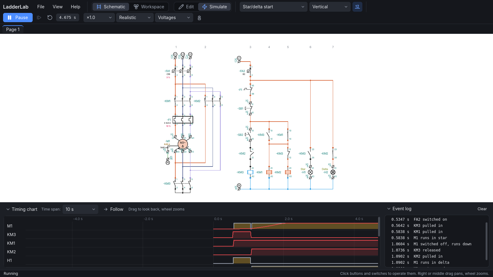
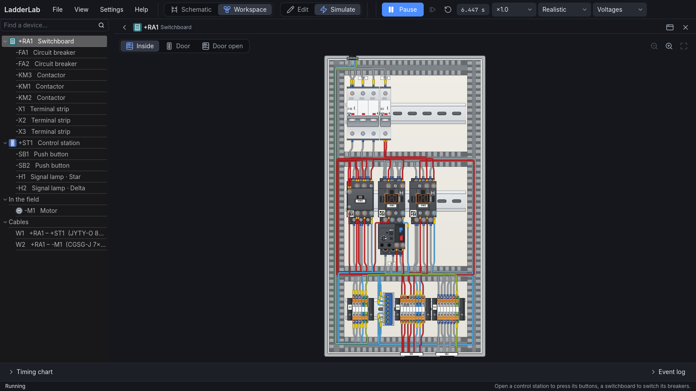
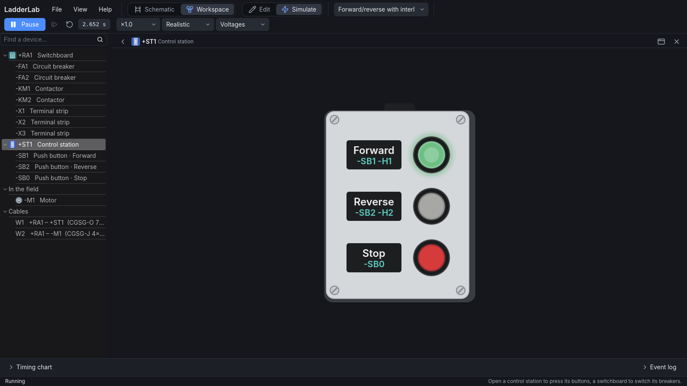
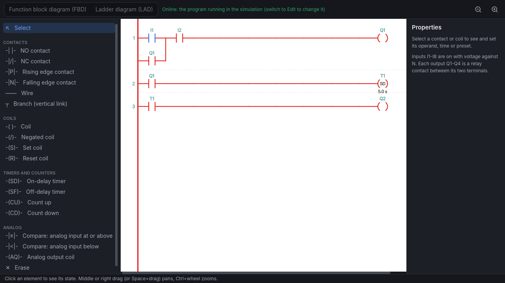

# LadderLab

A free simulator of relay control circuits for learning and teaching electrical
control. Draw a schematic with IEC 60617 symbols, switch to simulation and operate
the push buttons and switches: contactors pick up, contacts change over, lamps light
up, motors start, and the wires show where the voltage reaches.

The application is in English and Czech, and follows Czech practice
(ČSN EN 60617 / 81346 / 60947 / 60445): designations such as -KM1, -KA1, -KT1, -SB1,
contact numbering 13-14 / 21-22, coils A1-A2.



## Features

- **Schematic editor**: supplies (L1 L2 L3 N PE, DC + and - of 12-220 V), push buttons,
  switches, limit switches, NO / NC / changeover contacts, contactors and relays,
  multifunction time relays (F1-F12), lamps, fuses and fuse holders, circuit breakers,
  overload relays, three-phase motors (star/delta, Dahlander, separate windings, drawn as
  their terminal box if you like), bridge rectifiers, a temperature sensor (0-10 V), a
  frequency inverter, terminal strips and two PLCs: a logic module (8 inputs, 4 relay
  outputs, expansion and analog modules) and a compact 24 V DC CPU in three sizes with
  signal modules. Coils, lamps and PLCs carry a rated voltage. Undo / redo, rotating and
  mirroring (several parts together), wires that find their way around the symbols, wire
  numbering, multi-page schematics with page connectors.
- **Datasheets**: every part has a datasheet laid out like a manufacturer's, built from the
  part itself: every terminal with its function, technical data, the timing diagram or
  time-current characteristic and the device front with its terminal markings; exported as
  PDF.
- **Simulation**: ideal (instant) or realistic switching with pick-up and drop-out times,
  a timing chart and event log. 230 V / 400 V and DC supplies: parts with too low a voltage
  do not work, with far too high a voltage they burn out. Real currents (current view, clamp
  meter), motors that behave like induction motors, fuses, breakers and overload relays that
  trip after their characteristic, DC braking, the frequency inverter running its motor
  along its ramps, analog 0-10 V signals. Keys of the keyboard operate push buttons and
  switches; a motor can move a part such as a gate that operates limit switches.
- **PLC programming**: the PLC's program in a window of its own, as a function block
  diagram (FBD: AND, OR, NOT, NAND, NOR, XOR, on- and off-delays, latching and pulse relays,
  up/down counter, analog trigger, comparator and amplifier) or a ladder diagram (LAD: one
  endless power rail, NO/NC, edge and comparing contacts, coils, negated coils, set/reset,
  timer, counter and analog output coils), in the style of Siemens programming software; the
  compact CPU's addresses as on the real one (%I0.0, %Q0.0, %IW64); a built-in simulation
  with input switches and output lamps tests the program on its own, and while the schematic
  is simulated it shows the running program (signals, power flow, times and counts).
- **Workspace**: switchboards, control stations and groups of parts in the field (motors,
  limit switches, sensors) placed on a plan, with the cables between them worked out from the
  wiring, typed (CGSG-J or H07RN-F) and sized; a click on a cable lists its cores.
- **Control stations**: push buttons, selector switches, signal lamps and illuminated
  buttons drawn like real ones, that operate the simulated circuit.
- **Switchboard** (rozvaděč): DIN rails with the breakers, fuse holders, contactors,
  overload relays, relays, time relays, PLCs, frequency inverters and terminal strips of the
  schematic, drawn like the real cabinet and wired after the circuit through the ducts, with
  the field cables going out through glands; they show the simulation and breakers and fuses
  are switched there.
- **Export**: the page shown as PNG or a PDF on A4 / A3 sheets with a frame and title block,
  shown first in a preview; the PDF holds, as ticked, the schematic, the control stations,
  the switchboards, the workspace and a parts list.
- **Recovery**: a copy of unsaved work is kept after every edit and offered back after a
  crash.
- **Examples**: self-holding start/stop, forward/reverse, star/delta start, time relays,
  two-speed motors, DC braking, a schematic on three pages, a PLC start/stop and more.

## Screenshots

| Switchboard | Control station | PLC program |
| --- | --- | --- |
| [](docs/screenshots/switchboard.png) | [](docs/screenshots/station.png) | [](docs/screenshots/plc.png) |
| DIN rails, breakers, contactors and terminal strips drawn like the real cabinet, wired after the schematic | Push buttons and signal lamps that operate the simulated circuit | A ladder diagram running in the simulation, power flow shown live |

## Download

Get the latest version from the [Releases](https://github.com/JarasonPC/ladder-lab/releases)
page: unzip it and run `LadderLab.exe` (Windows, 64-bit). Schematics are saved as
`.ladder` files.
The program is not signed yet, so Windows may show "Windows protected your PC" the first
time: click **More info** and then **Run anyway**.

What changed in each version is in the [changelog](CHANGELOG.md). LadderLab tells you when
a new version is out (Help > Check for updates).

## Building from source

1. Install [Godot](https://godotengine.org/) 4.7 (standard version, not .NET).
2. Clone this repository and open `project.godot` in Godot.
3. Press F5 to run, or use Project > Export to build the Windows version
   (the export templates are installed from the Export dialog).

Run the tests (GUT) with:

```
godot --headless -s addons/gut/gut_cmdln.gd
```

How the code is organised is described in [docs/DEVELOPMENT.md](docs/DEVELOPMENT.md).

## Code signing, privacy and security

- [Code signing policy](CODE_SIGNING.md): how the Windows builds are made and signed, and
  what LadderLab changes on your computer
- [Privacy policy](PRIVACY.md): LadderLab collects no data; its only automatic network
  request is the update check, which can be turned off
- [Security](SECURITY.md): how to report a security problem privately

## Reporting problems

Report bugs and suggest improvements in the
[Issues](https://github.com/JarasonPC/ladder-lab/issues). Attaching the `.ladder` file
helps a lot.

## License

Copyright © 2026 Jaroslav Krnínský

LadderLab is free software: you can redistribute it and/or modify it under the terms of
the GNU General Public License as published by the Free Software Foundation, either
version 3 of the License, or (at your option) any later version. It is distributed in
the hope that it will be useful, but WITHOUT ANY WARRANTY; see the [LICENSE](LICENSE)
file for details.

LadderLab is made with the [Godot Engine](https://godotengine.org/license) (MIT license).
The tests use [GUT](https://github.com/bitwes/Gut) (MIT license).
